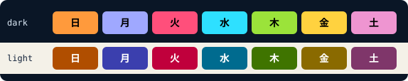
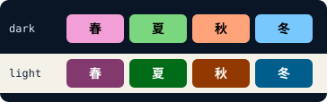
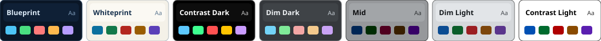

# colorole

役割 → 色の辞書。Blueprint (青図 / 白図) と灰の段 (黒〜白 5 段) のテーマ × core 色 (曜日・季節) の**正本**と、そこから各ツールのテーマを作る生成器。

- demo: https://elzup.github.io/colorole/ (テーマ × core 色 × 適用先のシミュレーション)
- データ: https://elzup.github.io/colorole/colors.json (全テーマ × 全 core 色の解決済みの値)

## 正本は 2 つ

| 正本 | 中身 | 誰が触るか |
|---|---|---|
| `groups/*.json` | **core 色のグループ** (曜日など)。メンバーごとに dark 用 / light 用の hex を 1 色ずつ | 人が hex を選んで貼る / agent が `nr pick` で書く |
| `src/tokens.ts` | **テーマ** (下地・面・文字・線・意味色)。Blueprint / Contrast / Dim × dark / light | 骨格を変えるときだけ |

core 色は primary (ボタン)・accent (縁取り・keyword) になり、下地・面・線・文字はその色相に染まる (明度はテーマのまま)。
意味色 (green = 一致 / red = 失敗 / orange = 注意 / violet = 要確認) は core で変えない。

```
groups/*.json ─┐
src/tokens.ts ─┴→ src/dictionary.ts  役割 → 色 の辞書 (bg, surface, text, action, success …)
                  src/generate.ts    core で染める → primary と意味色の衝突を解く (明度で分ける)
                  src/targets.ts     適用先ごとの key 変換表 (shadcn / MUI / VSCode / 構文 / ANSI / report)
                    → dist/tokens.css / dist/vscode/ / dist/zed/ / dist/colors.json / demo
```

## 色を選ぶ・足す

### 手で選ぶ

1. 下の「色の一覧」で今の色と隙間を見る (demo の「並び」で全適用先に当てた見た目も見られる)
2. 候補を測る。基準を満たさなければ終了コード 1

```bash
nr pick -- --group week --key sat --dark '#ee95d1' --light '#7f366a'
```

3. 良ければ `--write` を付けて書き込み、`nr gen && nr docs` で反映する (`groups/week.json` を直接編集してもよい)

測るもの: 全テーマの地との本文コントラスト (4.5:1)、同じグループの他の色・意味色との OKLab 距離
(一般色覚と、色覚シミュレーション P / D / T 型)。不合格は「本文コントラスト不足」と「一般色覚で他の色と衝突 (< 0.10)」だけで、
それ以外の近さは `warn` (色相だけで 11 色を分けきるのは無理なので、曜日名などの文字・位置を併用する前提)。

### グループを足す

`groups/<id>.json` を `groups/schema.json` の形で置くだけ (または `nr pick -- --group <id> --key <key> --label <Label> --ja <字> --dark … --light … --write` で 1 色ずつ)。
出力名は `blueprint-dark-<id>-<key>` になる (曜日 `week` だけは互換のため `blueprint-dark-sun`)。

### agent から使う

- 値だけ欲しい: `colors.json` の `variants[テーマ id][core id][役割]`、適用先の key なら `targets[適用先][テーマ id][core id][key]`
- 色を変えたい: `nr pick` で測ってから `--write`。README の一覧は `nr docs` で作り直す (手で hex を書かない)

## 使い方

```bash
nr gen               # dist/tokens.css / dist/vscode/ / dist/zed/
nr docs              # README の「色の一覧」・docs/swatches/*.svg・dist/colors.json
nr demo              # dist/demo.html を作って開く
nr audit             # 構文色・UI の衝突とコントラストの監査
nr sync:report       # ../agent-setup/templates/report-theme.css のトークン部分を更新
nr install:vscode    # .vsix を組んで code --install-extension (symlink では VSCode が認識しない)
nr install:zed       # ~/.config/zed/themes/blueprint.json に symlink
nr switch -- --dry-run          # 今日の曜日に切り替えた場合の変更点だけ表示
nr switch -- --day tue --palette contrast
```

テーマ名は `Blueprint Dark · Tue` / `Contrast Light · Sat` / `Mid · Spring` の形式。core なし (`Blueprint Dark`) は元の accent を使う。

<!-- @@COLORS:BEGIN (node src/gen-readme.ts が生成。手で編集しない) -->
## 色の一覧

生成の既定: 染め具合 100%・衝突の解き方 tone-split。地とのコントラストは Blueprint / Whiteprint の地 (`#0a1626` / `#f4f1e8`) に対する比。4.5 未満の色は、生成時に色相を保ったまま明度だけ持ち上げる。

### 曜日 (`groups/week.json`)

種類: rotation (日によって入れ替わる。並べて見分けられる必要がある)

七曜の字に寄せた core 色。テーマ名・出力ファイル名は互換のためグループ名を付けない (Blueprint Dark · Sun / blueprint-dark-sun)



| id | 表示 | 由来 | dark | light | 地とのコントラスト (dark / light) |
|---|---|---|---|---|---|
| `sun` | 日 Sun | 橙 (太陽) | `#ff9a3c` | `#b04e00` | 8.60 / 4.72 |
| `mon` | 月 Mon | 藍 (月光) | `#9fa8ff` | `#3b3fae` | 8.24 / 7.41 |
| `tue` | 火 Tue | 紅 | `#ff4f7b` | `#c0003c` | 5.76 / 5.62 |
| `wed` | 水 Wed | シアン | `#2ee0ff` | `#006b8f` | 11.44 / 5.31 |
| `thu` | 木 Thu | 若葉 | `#9be33a` | `#3f7400` | 11.63 / 5.01 |
| `fri` | 金 Fri | 山吹 | `#ffd23f` | `#8a6a00` | 12.58 / 4.49 |
| `sat` | 土 Sat | 牡丹 | `#ee95d1` | `#7f366a` | 8.53 / 7.05 |

### 季節 (`groups/season.json`)

種類: rotation (日によって入れ替わる。並べて見分けられる必要がある)

四季の字に寄せた core 色。日付から季節を選んで回す想定



| id | 表示 | 由来 | dark | light | 地とのコントラスト (dark / light) |
|---|---|---|---|---|---|
| `season-spring` | 春 Spring | 桜 | `#f19fd6` | `#82396d` | 9.23 / 6.75 |
| `season-summer` | 夏 Summer | 青葉 | `#7bd77f` | `#006c18` | 10.27 / 5.89 |
| `season-autumn` | 秋 Autumn | 紅葉 | `#ffa47a` | `#913900` | 9.38 / 6.67 |
| `season-winter` | 冬 Winter | 氷 | `#78c7fd` | `#005e8d` | 9.85 / 6.23 |

### テーマ (`src/tokens.ts`)



core なしの値。全 24 役割と core ごとの値は `colors.json` にある。

灰の地は明度の段で並ぶ: 黒 Contrast Dark (`#000000`) → 濃灰 Dim Dark (`#35383c`) → 中灰 Mid (`#96989b`) → 淡灰 Dim Light (`#d5d8db`) → 白 Contrast Light (`#ffffff`)。真ん中の L 0.5 前後は白文字・黒文字とも 4.6:1 で頭打ちになるため、中灰は明るい側 (L 0.68・黒文字) に寄せている。

| 役割 | Blueprint | Whiteprint | Contrast Dark | Dim Dark | Mid | Dim Light | Contrast Light |
|---|---|---|---|---|---|---|---|
| `bg` | `#0a1626` | `#f4f1e8` | `#000000` | `#35383c` | `#96989b` | `#d5d8db` | `#ffffff` |
| `surface` | `#0f2036` | `#fbf9f3` | `#0d0d0d` | `#3f4347` | `#a2a5a8` | `#e2e5e8` | `#ffffff` |
| `text` | `#dceaf7` | `#16304d` | `#ffffff` | `#eff2f5` | `#0c0d0f` | `#171b1f` | `#000000` |
| `textMuted` | `#7b98b5` | `#5b7690` | `#c4c4c4` | `#c4cbd2` | `#2e3133` | `#43484e` | `#333333` |
| `border` | `#1c2e42` | `#d0d4d3` | `#4d4d4d` | `#55585b` | `#787a7c` | `#afb1b3` | `#8c8c8c` |
| `accent` | `#4dc4f5` | `#0b6f9e` | `#5cc8ff` | `#73d3f7` | `#002655` | `#0b4c92` | `#0050b3` |
| `action` | `#26a7d7` | `#004c6f` | `#4ab8ee` | `#4eafd2` | `#00092b` | `#4985d0` | `#2269ce` |
| `success` | `#4ade80` | `#12784a` | `#3dff8f` | `#7fe998` | `#002c02` | `#0b5d2a` | `#006b2e` |
| `danger` | `#ff7a7a` | `#b3261e` | `#ff5050` | `#f3a6a5` | `#500020` | `#9b1e22` | `#b00000` |
| `warning` | `#ffb84d` | `#9a5c00` | `#ffc400` | `#f4c98d` | `#381f00` | `#7d460b` | `#8a4b00` |
| `notice` | `#b79cff` | `#5b3fb8` | `#c99bff` | `#c9a3f5` | `#370067` | `#5a358c` | `#5a1fb0` |

<!-- @@COLORS:END -->

## 注意

- VSCode の `settings.json` にある `workbench.colorCustomizations` はテーマより優先される。直書きの hex が残っていると曜日色を上書きする。
- Zed の `theme_overrides` はテーマ名ごとの設定なので、`Ayu Dark` 向けに書いたものは Blueprint には効かない。
- VSCode / Zed の生成はまだ「core で染める」を通っていない (曜日色が当たるのは accent まわりだけ)。
